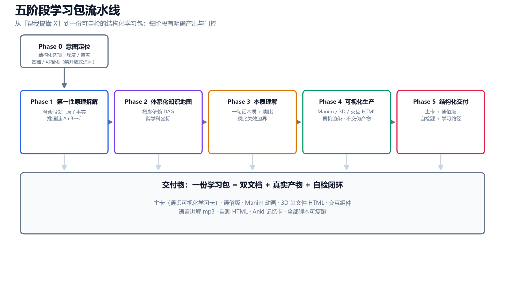
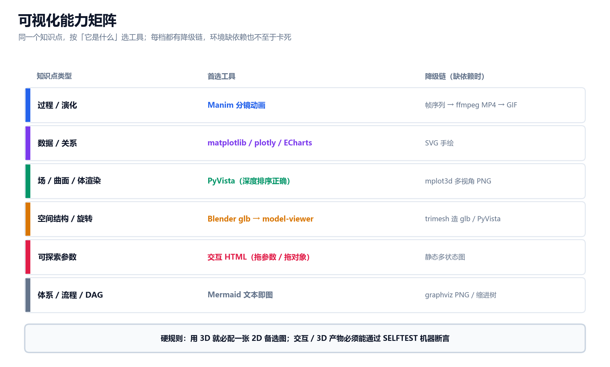
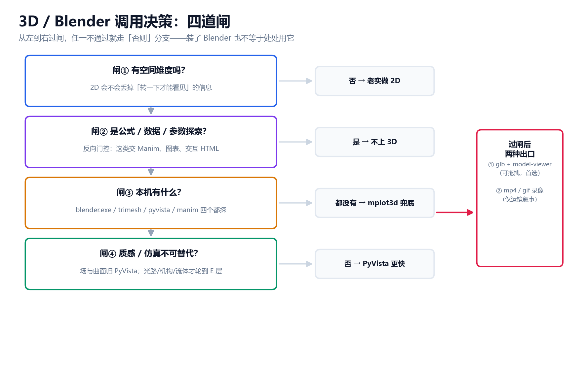
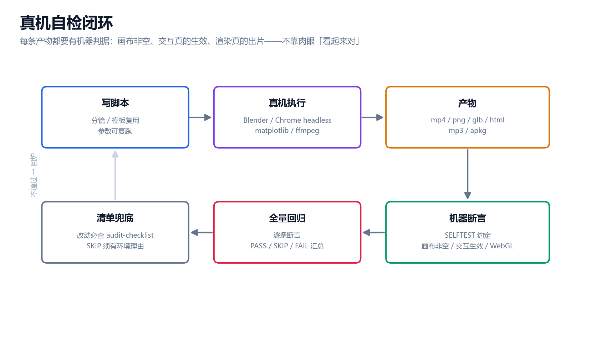
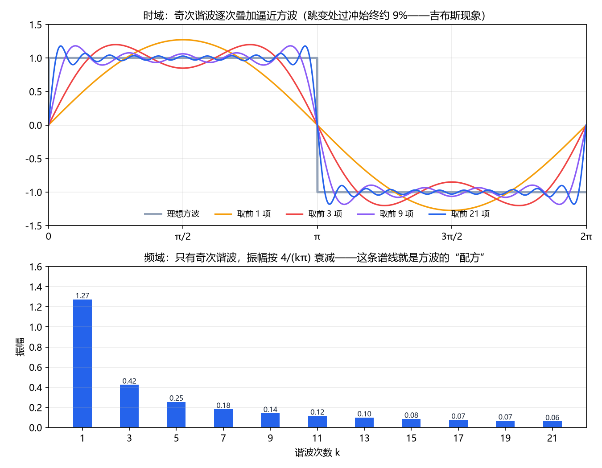
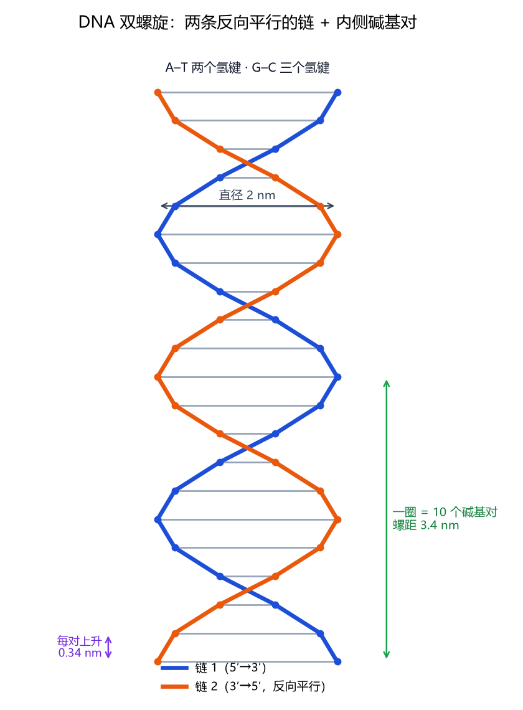

# General Knowledge Tutor · 通识可视化学习导师

> 把「学一个东西」从线性阅读升级成一条固定流水线：**先拆到底层 → 再建体系 → 配可视化 → 讲清本质 → 自检闭环**。
> 平台无关的 AI 智能体技能（Agent Skill）：Claude Code / OpenClaw / WorkBuddy / Cursor / WPS AI / Codex 等均可用。

**三份文档分工**：[README](README.md) 是门面（你现在看的）· [用户手册](USER_GUIDE.md) 教你怎么用 · [技术手册](TECHNICAL.md) 讲原理与二次开发。

> 当前版本：v1.5.9（2026-10-26）· 更新日志见 [TECHNICAL.md](TECHNICAL.md) §7

---

## 一、它到底做什么

你对 AI 说「帮我搞懂傅里叶变换」，普通回答是一篇讲解；这个技能会走完五阶段，交付一份**带真实产物的学习包**。



*图 1 · 五阶段流水线：每阶段有明确产出与门控，不是「写一篇长文」*

| 学习痛点 | 本技能的做法 |
|---|---|
| 记住结论，说不出为什么 | Phase 1 把概念拆到原子事实，重建「A + B → C」的推理链 |
| 学完是孤立的，不成体系 | Phase 2 画概念依赖 DAG，标出先学 / 后学与跨学科坐标 |
| 名词都懂，没有直觉 | Phase 3 一句话本质 + 生活类比，**每个类比都附失效边界** |
| 抽象概念看不见摸不着 | Phase 4 真机渲染动画 / 3D / 交互组件，脚本可复跑 |
| 学完不知道会不会 | Phase 5 自检题 + 学习路径检查点，交付双文档（主卡 + 通俗版） |

## 二、可视化不是装饰，是选型

同一个知识点，按「它是什么」选工具；每一档都写好了降级链，环境缺依赖也不至于卡死。



*图 2 · 能力矩阵：过程演化走 Manim，场与曲面走 PyVista，空间结构走 glb + model-viewer*

## 三、3D 什么时候上？先过四道闸

「装了 Blender 就到处用」是反模式。技能里固化了四道判定闸，任一不通过就走它的「否则」分支：



*图 3 · 四道闸：空间维度 → 反向门控 → 依赖探测 → 质感门槛*

关键判据只有一句：**把 3D 换成 2D，会不会丢掉「转一下才能看见」的信息？** 会，才上 3D。

而且**没有 Blender 不等于做不了可交互 3D**：trimesh 纯 Python 也能造 glb，再内联成单文件 HTML，断网双击可开。

## 四、产物不是「看起来对」

人眼会被白屏、死控件、CDN 失败骗过去，所以每条交互 / 3D 产物都必须通过机器断言：



*图 4 · 自检闭环：真机执行 → 产物 → SELFTEST 断言 → 全量回归，不通过就回炉*

## 五、真实产出示例

下面两张都是本技能在真实会话里跑出来的（脚本仍在仓库外的学习包目录中，可复跑）：



*示例 A · 傅里叶变换：上半是奇次谐波逐次叠加逼近方波，下半是它的「配方」频谱*



*示例 B · DNA 双螺旋：2D 备选图（凡上 3D 必配一张 2D 降级图）*

## 六、30 秒上手

```bash
git clone https://github.com/Asaceoo/general-knowledge-tutor-skills.git
cp -r general-knowledge-tutor-skills ~/.claude/skills/general-knowledge-tutor   # Claude Code
# OpenClaw / WorkBuddy 复制到各自技能目录即可；Cursor 等无技能机制的见用户手册
```

然后直接说人话就行：

```text
用第一性原理讲讲熵到底是什么
梯度下降我老是没直觉，做个动画帮我理解
系统学一下复利，给我画出来，最好能转着看
出几道题测测我到底懂没懂
```

## 七、文档与配套

| 文件 | 用途 |
|---|---|
| [USER_GUIDE.md](USER_GUIDE.md) | **用户手册**：安装、怎么问、产物怎么读、FAQ |
| [TECHNICAL.md](TECHNICAL.md) | **技术手册**：架构、五阶段规范、脚本、坑表、版本史 |
| [references/audit-checklist.md](references/audit-checklist.md) | 对抗性审查台账：改了技能必须先过这张清单 |
| [SKILL.md](SKILL.md) | 技能主体（智能体读取的执行规范） |
| [test-prompts.json](test-prompts.json) | 触发测试用例（应命中 / 不应命中） |

## 八、质量承诺

- **不交付伪产物**：所有可视化脚本真实运行，产物要通过存在性、可播放性、中文渲染检查。
- **交互 / 3D 有机器断言**：`window.__SELFTEST__()` + `scripts/selftest_web.py`，退出码为 0 才算通过。
- **事实优先核验**：不确定处标注「待核验」并给出验证路径，不编造数据与来源。
- **降级要真就绪**：凡上 3D 必配 2D 备选图；缺依赖时按能力拆开降级，而不是硬塞给做不了的库。

## 九、License

见 [LICENSE](LICENSE)。
