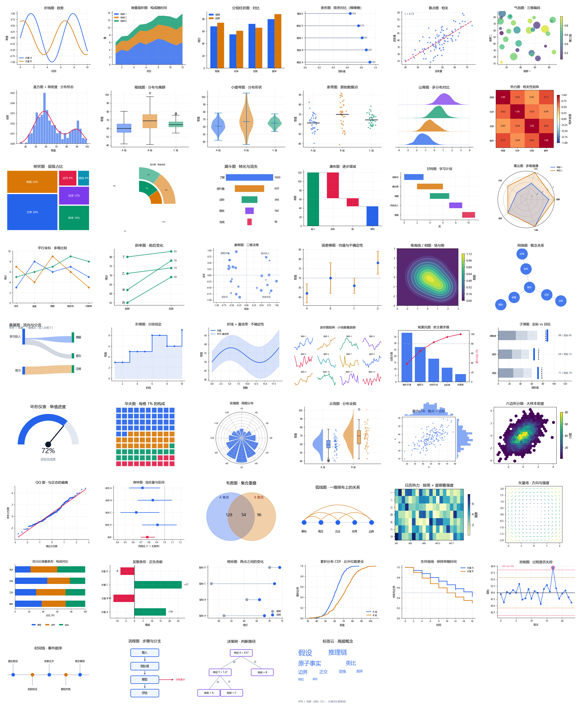

# General Knowledge Tutor · 通识可视化学习导师

> 把「学一个东西」从线性阅读，升级成一条固定流水线：**拆到底层 → 建体系 → 配可视化 → 讲清本质 → 自检闭环**。
> 平台无关的 AI 智能体技能（Agent Skill）：Claude Code / OpenClaw / WorkBuddy / Cursor / WPS AI / Codex 等均可用。

**三份文档**：[README](README.md)（用法与实例，你在看的）· [用户手册](USER_GUIDE.md)（安装、产物、FAQ）· [技术手册](TECHNICAL.md)（架构、脚本、坑表）。

> 当前版本：v1.9.0（2026-10-29）· 更新日志见 [TECHNICAL.md](TECHNICAL.md) §7

---

## 一、它解决什么问题

问 AI「什么是傅里叶变换」，通常得到一篇读起来顺、但**看完还是不会**的讲解。这个技能把「学会」拆成五步，每步都有可检查的产出：


*图 1 · 五阶段流水线：每阶段有明确产出与门控*

| 学习痛点 | 本技能的做法 |
|---|---|
| 记住结论，说不出为什么 | Phase 1 拆到原子事实，重建「A + B → C」的推理链 |
| 学完是孤立的 | Phase 2 画概念依赖 DAG，标出先学 / 后学与跨学科坐标 |
| 名词都懂，没直觉 | Phase 3 一句话本质 + 生活类比，**每个类比附失效边界** |
| 抽象内容看不见 | Phase 4 真机渲染动画 / 3D / 交互组件 / 图表（**52 种**可选） |
| 学完不知会不会 | Phase 5 自检题 + 学习路径，交付主卡 + 通俗版双文档 |

## 二、30 秒安装

```bash
git clone https://github.com/Asaceoo/general-knowledge-tutor-skills.git
cp -r general-knowledge-tutor-skills ~/.claude/skills/general-knowledge-tutor   # Claude Code
```

其他宿主：OpenClaw / WorkBuddy 复制到各自技能目录；Cursor 等无技能机制的，把 `SKILL.md` 贴进项目规则（详见 [用户手册](USER_GUIDE.md) §1）。

装完无需配置——**说人话就会触发**。

## 三、用法（使用说明）

### 3.1 基本用法：一句话就够

```text
帮我搞懂傅里叶变换
熵到底是什么？通俗但要严谨
梯度下降我没直觉，做个动画
```

技能会自动判断深度、是否需要前置知识、配哪种可视化，然后走完五阶段。

### 3.2 它会先问你 4 个问题（可以跳过）

| 维度 | 选项 | 影响 |
|---|---|---|
| 学习深度 | 速览 / 精通 / 输出 | 速览只出通俗版；精通出双文档 + 可视化 |
| 覆盖范围 | 单点 / 带前置 / 完整体系 | 是否把前置概念一并讲清 |
| 前置基础 | 零基础 / 有相关背景 / 专业 | 决定类比深度与术语密度 |
| 可视化形式 | 动画 / 交互图 / 3D / 配音 / 记忆卡 / 自动 | 可多选；不选就交给选型矩阵 |

不想被问就直接说清需求（「精通 + 带前置 + 要 3D」），或答「你定」。未确认时走默认：精通 + 带前置 + 有相关背景 + 可视化自动，并在交付物开头标注这个假设。

### 3.3 拿到的东西长什么样

| 产物 | 说明 |
|---|---|
| `[主题]—通识可视化学习卡.md` | 主卡：本质 → 拆解 → 体系 → 类比 → 边界 → 可视化 → 学习路径 → 自检 |
| `[主题]—通俗版.md` | 通俗版，≤ 主卡 40% 篇幅，禁用元词汇 |
| `[主题]—*.mp4` / `*.png` | 动画与静态图（**凡上 3D 必配 2D 备选图**） |
| `[主题]—3D结构.html` | 可拖拽单文件 3D，断网双击可开 |
| `[主题]—自测N题.html` / `—记忆卡.apkg` | 自动判分自测 / Anki 记忆卡 |
| `[主题]—语音讲解.mp3` / `.srt` | 中文配音与字幕 |

### 3.4 迭代与微调

```text
刚才那个 3D 转太快了，慢一点          # 脚本保留，改参数重跑
只做第一性原理拆解，别画图            # 单阶段产物
换成桑基图，我要看流向                # 点名指定图表
出 5 道题测测我到底懂没懂              # 追加自测
```

## 四、20 个使用实例

| # | 你想做什么 | 你可以这样说 | 你会得到 |
|---|---|---|---|
| 1 | 入门一个抽象概念 | 用第一性原理讲讲「熵」到底是什么 | 主卡 + 通俗版 + 类比与失效边界 |
| 2 | 建立直觉 | 梯度下降我没直觉，做个动画帮我理解 | Manim 分镜动画 mp4 |
| 3 | 系统学一门学科 | 系统学一下复利，给我画出来 | 依赖 DAG + 图表 + 双文档 |
| 4 | 判断数据分布 | 这批成绩是偏态吗？有没有双峰 | 直方图+KDE + 箱线 + 云雨图 |
| 5 | 比较两组变化 | 前后测到底有没有提升 | 哑铃图 / 斜率图 + 误差棒 |
| 6 | 找主要矛盾 | 影响成绩的原因里，哪几个最要命 | 帕累托图（80/20） |
| 7 | 看构成变化 | 生源构成这几年怎么变的 | 百分比堆叠条形 / 树状 / 旭日 |
| 8 | 看流向分流 | 学习投入都去哪了，为什么记不住 | 桑基图（带宽 ∝ 数量） |
| 9 | 看转化流失 | 从试听到报名，哪一步掉得最多 | 漏斗图 |
| 10 | 看周期节律 | 一年里哪几个月最忙 | 玫瑰图 / 日历热力 |
| 11 | 看两个变量关系 | 题目难度和得分有关系吗 | 散点 + 拟合 + r / 相关矩阵 |
| 12 | 多维权衡 | 三个方案怎么权衡，各自强在哪 | 平行坐标 / 雷达图 |
| 13 | 排计划 | 把 30 天复习计划排出来 | 甘特图 |
| 14 | 讲清步骤 | 这个算法的流程画出来 | 流程图 / 状态机（Mermaid） |
| 15 | 空间结构 | DNA 双螺旋长什么样，我要能转着看 | glb + model-viewer 单文件 HTML |
| 16 | 场与曲面 | 电势分布是什么形状 | PyVista 渲染 / 等高线相图 |
| 17 | 自测掌握度 | 出 5 道题测测我懂了没 | 自测 HTML（自动判分）+ 记忆卡 |
| 18 | 通勤时听 | 做成语音讲解，我路上听 | edge-tts mp3 + srt 字幕 |
| 19 | 讲给外行 | 用大白话讲给完全不懂的人 | 通俗版（≤ 主卡 40%，禁术语堆砌） |
| 20 | 面试 / 讲课 | 我要去面试，帮我准备这个主题 | 主卡 + 分镜 + 预设追问 Q&A |

## 五、图表：52 种，按需调用

图表不是只有柱状和折线。按「读者要回答什么问题」选图，而不是按图形名选：


*图 2 · 能力矩阵：每档都有降级链，缺依赖也不至于卡死*

### 5.1 只画你要的那一张

```bash
python scripts/chart.py --list              # 按 12 个分类列出 52 种
python scripts/chart.py --search 分布        # 关键词检索
python scripts/chart.py 箱线图 --out a.png   # 只渲染这一张
python scripts/chart.py --all               # 全量 + 拼版（发版用）
```

退出码约定：`0` 成功（含「无匹配」）/ `1` 名称未知 / `2` 参数或运行错误——方便脚本判断。



*图 3 · 52 种图表（`scripts/chart.py --all` 真实渲染，可复跑）*

### 5.2 覆盖哪十类问题

比较（分组柱 / 棒棒糖 / 子弹 / 哑铃 / 斜率 / 雷达 / 象限 / 发散 / 帕累托）· 趋势（折线 / 面积 / 阶梯 / 置信带 / 迷你图 / CDF / 控制图）· 分布（直方+KDE / 箱线 / 小提琴 / 条带 / 山脊 / 云雨 / QQ）· 关系（散点 / 气泡 / 相关矩阵 / 平行坐标 / 联合分布 / 六边形）· 构成（树状 / 旭日 / 瀑布 / 华夫 / 百分比堆叠）· 流向（桑基 / 漏斗 / 弧线）· 过程（甘特 / 时间线 / 流程图 / 决策树 / 生存曲线）· 空间与场（等高线 / 矢量场 / 日历热力 / 玫瑰）· 推断（误差棒 / 森林）· 结构（网络 / 韦恩 / 标签云）。

### 5.3 什么时候上 3D


*图 4 · 四道闸：空间维度 → 反向门控 → 依赖探测 → 质感门槛*

判据只有一句：**把 3D 换成 2D，会不会丢掉「转一下才能看见」的信息？** 会，才上 3D。且「没装 Blender」不等于做不了可交互 3D——`trimesh` 也能造 glb。

## 六、产物不是「看起来对」


*图 5 · 自检闭环：真机执行 → SELFTEST 断言 → 全量回归，不通过就回炉*

- 所有可视化脚本真实运行，不交付「看起来对」的伪产物。
- 交互 / 3D 产物必须暴露 `window.__SELFTEST__()` 并通过 `scripts/selftest_web.py`（退出码 0 才算过）。
- 事实优先核验；不确定处标「待核验」并给验证路径。

## 七、真实产出示例


*示例 A · 傅里叶变换：奇次谐波叠加逼近方波 + 它的「配方」频谱*

## 八、文档与配套

| 文件 | 用途 |
|---|---|
| [USER_GUIDE.md](USER_GUIDE.md) | 用户手册：安装、怎么问、产物怎么读、FAQ |
| [TECHNICAL.md](TECHNICAL.md) | 技术手册：架构、规范、脚本、坑表、版本史 |
| [references/chart-catalog.md](references/chart-catalog.md) | 图表目录：52 种 + 选图决策树 + 反模式 |
| [references/audit-checklist.md](references/audit-checklist.md) | 对抗性审查台账（改动前必看） |
| [SKILL.md](SKILL.md) | 技能主体（智能体读取的执行规范） |

## 九、License

见 [LICENSE](LICENSE)。
